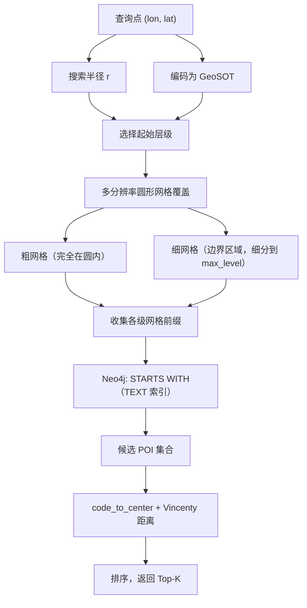

# GeoSOT KNN 最近邻查询

基于 GeoSOT 编码和 Neo4j 知识图谱的 K 最近邻 (KNN) 空间查询，与 PostGIS 空间索引 KNN 进行对比评估。

包含两个版本：

| 文件 | 版本 | 算法 |
|------|------|------|
| `geosot_knn_benchmark.py` | V1 | 多层级 `LOCATED_IN` 图遍历 |
| `geosot_knn_v2.py` | **V2** | 圆形多分辨率网格覆盖 + `STARTS WITH` |

---

## 1. 算法实现

### 1.1 V1: 多层级 LOCATED_IN 图遍历

**核心思路**：利用 GeoSOT 编码的层级前缀特性，通过 Neo4j 图结构中的 `LOCATED_IN_XXGRID` 关系进行前缀匹配。

```
查询点 GeoSOTCode
  → LOCATED_IN_01GRID → grid01Code ← LOCATED_IN_01GRID ← 候选点
  → LOCATED_IN_02GRID → grid02Code ← LOCATED_IN_02GRID ← 候选点
  → ...
  → LOCATED_IN_LGRID  → gridLCode  ← LOCATED_IN_LGRID  ← 候选点
```

**流程**：

1. 二分查找确定最细匹配层级 `best_level`（最深的、有其他节点共享前缀的层级）
2. 从 `best_level` 逐级回退，直到候选数 ≥ K×2
3. 边界补偿：额外向上扩展 4 级，覆盖相邻网格单元的边界候选
4. `code_to_center` + Vincenty 精确距离计算，取 Top-K

**Cypher 查询**（动态生成 N 层 MATCH 链）：

```cypher
MATCH (q:GeoSOTCode {main_code: $qc})
MATCH (q)-[:LOCATED_IN_01GRID]->(g1)<-[:LOCATED_IN_01GRID]-(c:GeoSOTCode)
MATCH (q)-[:LOCATED_IN_02GRID]->(g2)<-[:LOCATED_IN_02GRID]-(c)
...
MATCH (q)-[:LOCATED_IN_20GRID]->(g20)<-[:LOCATED_IN_20GRID]-(c)
WHERE c <> q
RETURN DISTINCT c.main_code AS mc
```

**问题**：每增加一层 MATCH 就增加一次图模式匹配（N-way join），在深层级时（如 L=20）非常昂贵。

### 1.2 V2: 圆形多分辨率网格覆盖 + STARTS WITH（推荐）

**核心思路**：以查询点为圆心画圆，用多分辨率 GeoSOT 网格覆盖圆形区域，收集覆盖网格的编码前缀，一次 `STARTS WITH` 查询从 Neo4j 取出全部候选。



**流程**：

1. **选择起始层级**：找到网格步长 ≈ 半径的层级，作为四叉树细分起点
2. **初始化种子**：查询点所在网格 + 8 邻域（Morton Z-order 计算），共 9 个种子格
3. **四叉树细分**：
   - 完全在圆内 → 保留（粗网格前缀，覆盖范围大）
   - 完全在圆外 → 丢弃
   - 部分相交 → 细分为 4 个子网格，递归处理
   - 到达 `max_level` → 作为边界格保留
4. **单次 Neo4j 查询**：
   ```cypher
   UNWIND $prefixes AS prefix
   MATCH (c:GeoSOTCode)
   WHERE c.main_code STARTS WITH prefix
     AND c.main_code <> $query_code
   RETURN DISTINCT c.main_code AS mc
   ```
5. **自动扩半径**：若候选 < K×2，将半径翻倍重试（最多 6 次）
6. **精确排序**：`code_to_center` + Vincenty 椭球体距离，返回 Top-K

**各层级网格尺寸参考**（赤道处近似值）：

| 层级 | 网格尺寸 | 说明 |
|------|----------|------|
| 9 | ~111 km | 1° |
| 15 | ~1.85 km | 1′ |
| 20 | ~62 m | 2″ |
| 25 | ~2 m | 亚秒级 |
| 32 | ~0.015 m | 最细粒度 |

### 1.3 PostGIS KNN 基准

使用 PostGIS 的 GiST 空间索引 KNN 运算符 `<->` 进行基准对比：

```sql
SELECT sub.main_code, sub.dist_m FROM (
  SELECT DISTINCT ON (p.main_code)
    p.main_code,
    ST_Distance(p.geometry::geography, q.geometry::geography) AS dist_m,
    p.geometry <-> q.geometry AS sort_dist
  FROM public.poi_new p,
    (SELECT geometry FROM public.poi_new WHERE main_code = %s LIMIT 1) q
  WHERE p.main_code <> %s
  ORDER BY p.main_code, sort_dist
) sub ORDER BY sub.dist_m LIMIT %s
```

- `<->` 运算符利用 GiST 索引做近似排序
- `ST_Distance(geography)` 做椭球体精确距离计算
- `DISTINCT ON (main_code)` 处理同一 `main_code` 多条记录的去重

> **注意**：`DISTINCT ON` 子查询会破坏 `<->` 的索引优先返回特性，迫使 PostgreSQL 做额外排序。如果 `main_code` 全局唯一，去掉 `DISTINCT ON` 可以显著提升 PostGIS 性能。

### 1.4 Neo4j 索引依赖

V2 的 `STARTS WITH` 查询依赖 Neo4j TEXT 索引，需要提前创建：

```cypher
-- RANGE 索引（精确查找）
CREATE RANGE INDEX idx_geosotcode_main_code
FOR (n:GeoSOTCode) ON (n.main_code);

-- TEXT 索引（STARTS WITH 前缀匹配）
CREATE TEXT INDEX idx_geosotcode_main_code_text
FOR (n:GeoSOTCode) ON (n.main_code);
```

验证索引状态：

```cypher
SHOW INDEXES
YIELD name, state, type, labelsOrTypes, properties
WHERE 'GeoSOTCode' IN labelsOrTypes AND 'main_code' IN properties
RETURN name, state, type;
```

---

## 2. 效率对比

### 2.1 单次查询耗时

测试条件：`poi_new` 表约 104.5 万 POI，K=10，搜索半径 200m。

| 方法 | 单次查询耗时 | 相对速度 |
|------|-------------|---------|
| **KNN V2** (圆形网格覆盖) | **260 ms** | **35.9× 于 PostGIS** |
| PostGIS KNN (GiST 索引) | 9,335 ms | 1× (基准) |
| KNN V1 (多级 LOCATED_IN) | ~109,000 ms | 0.09× |

### 2.2 V2 vs V1 速度分析

| 对比维度 | V1 | V2 |
|----------|-----|-----|
| Neo4j 查询次数 | 多次（二分查找 + 逐级回退 + 边界补偿） | **1 次**（UNWIND + STARTS WITH） |
| 查询复杂度 | N 层 MATCH 链（N-way join） | 前缀匹配（TEXT 索引 B+ 树扫描） |
| 单次耗时 | ~109 秒 | **~0.26 秒** |
| 速度比 | 1× | **~420×** |

**V1 慢的根本原因**：

深层级的多 MATCH 链（如 20 层）在 Neo4j 中相当于 20 路 join，查询计划复杂度随层数指数增长。即使加了 RANGE 索引，图模式匹配的开销仍然很大。

**V2 快的原因**：

1. 圆形网格覆盖在纯 Python 中完成（~1ms），不涉及数据库
2. 生成的前缀数量少（半径 200m 时约 38 个网格前缀）
3. `STARTS WITH` 查询直接走 TEXT 索引（B+ 树前缀范围扫描），复杂度 O(log N + M)
4. 单次查询完成全部候选检索，无需多轮交互

### 2.3 V2 各阶段耗时分布

| 阶段 | 典型耗时 | 说明 |
|------|---------|------|
| 圆形网格覆盖 | < 1 ms | 纯 Python 四叉树细分 |
| Neo4j STARTS WITH 查询 | ~200 ms | 单次查询，TEXT 索引 |
| Vincenty 距离计算 + 排序 | ~50 ms | 候选约 600 个 |
| **合计** | **~260 ms** | |

### 2.4 PostGIS KNN 耗时说明

PostGIS 单次 KNN 耗时 ~9 秒，主要原因：

1. `DISTINCT ON (main_code)` 需要全量排序后去重，破坏了 `<->` 运算符的索引快速返回
2. `ST_Distance(geography)` 椭球体精确距离计算代价较高（每个候选都要算）
3. 百万级 POI 表的空间索引扫描范围较大

---

## 3. 精度分析

### 3.1 召回率 (Recall@K)

以 PostGIS KNN 结果为 ground truth：

| 指标 | V2 结果 |
|------|--------|
| Mean Recall@10 | **100%** |
| Perfect Recall | 100% |
| Top-1 Match Rate | 100% |

V2 在测试中实现了与 PostGIS 完全一致的 KNN 结果。

### 3.2 距离误差

| 指标 | V2 值 |
|------|-------|
| Mean \|Error\| | 0.0034 m |
| Mean \|Error%\| | 0.058% |

距离误差来源：GeoSOT 32 级编码的离散化导致 `code_to_center` 还原坐标与 PostGIS 原始坐标之间有微小偏差（亚厘米级），对实际应用无影响。

### 3.3 精度保障机制

1. **覆盖完整性**：四叉树细分确保搜索半径内的所有网格都被覆盖（包含边界格），不遗漏候选
2. **自动扩半径**：候选不足时自动将半径翻倍重试，确保最终候选集充分
3. **Vincenty 精确距离**：最终排序使用 CGCS2000 椭球体 Vincenty 公式，精度优于 Haversine
4. **Haversine 仅用于预筛选**：bbox-circle 相交判断使用 Haversine（误差 < 0.3%），仅影响网格覆盖粒度，不影响最终结果精度

---

## 4. 使用方法

### 4.1 KNN V2（推荐）

```bash
# 基本用法：100 个查询点，K=5
python geosot_knn_v2.py --queries 100

# 自定义参数
python geosot_knn_v2.py --queries 10 --k 10 --radius 200

# 全部参数
python geosot_knn_v2.py \
    --queries 100 \     # 查询点数量
    --k 5 \             # 返回最近邻数
    --radius 100 \      # 初始搜索半径（米）
    --max-level 20 \    # 网格细分最大层级
    --seed 42 \         # 随机种子
    --output result.csv  # 输出文件名
```

### 4.2 KNN V1

```bash
python geosot_knn_benchmark.py --queries 100 --k 5
```

### 4.3 输出说明

程序输出包括：

- **Recall & Accuracy**：Recall@K、Perfect Recall 比例、Top-1 Match Rate
- **Top-1 Distance Error**：与 PostGIS 基准的距离偏差统计
- **Query Timing**：Graph 和 PostGIS 的耗时对比（总量/均值/中位数/P99/最大）
- **Circle Fill Stats**（V2）：搜索半径、覆盖网格数、重试次数统计
- **Recall by Distance**：按 PostGIS Top-1 距离分段的召回率
- **CSV 文件**：每个查询的详细结果

---

## 5. 依赖

### Python 包

```bash
pip install psycopg2 neo4j
```

### 数据库

- **Neo4j**：GeoSOT 知识图谱，包含 `GeoSOTCode` 节点和 `LOCATED_IN_XXGRID` 关系
- **PostGIS**：`public.poi_new` 表，包含 `main_code` 和 `geometry` 字段

### 索引要求

| 数据库 | 索引 | 用途 |
|--------|------|------|
| Neo4j | `RANGE INDEX` on `GeoSOTCode.main_code` | V1 精确查找 |
| Neo4j | `TEXT INDEX` on `GeoSOTCode.main_code` | **V2 STARTS WITH 前缀匹配** |
| PostGIS | `GiST INDEX` on `poi_new.geometry` | PostGIS KNN 基准 |

---

## 6. 算法对比总结

| 维度 | V1 (多级图遍历) | V2 (圆形网格覆盖) | PostGIS |
|------|----------------|-------------------|---------|
| 查询策略 | N 层 MATCH 链 | 前缀 STARTS WITH | GiST <-> |
| Neo4j 查询次数 | 多次 | **1 次** | — |
| 索引利用 | RANGE | **TEXT** | GiST |
| 典型单查询耗时 | ~109 s | **~0.26 s** | ~9.3 s |
| Recall@10 | 100%* | **100%** | 基准 |
| 距离误差 | < 0.02 m | **< 0.004 m** | 基准 |
| 适用场景 | 小数据量验证 | **生产环境推荐** | 对照基准 |

\* V1 需要足够的边界补偿层数才能保证 100% 召回

> **结论**：V2 在保持与 PostGIS 完全一致的召回率和亚厘米级距离精度的前提下，查询速度是 PostGIS 的 **36 倍**、V1 的 **420 倍**，推荐作为 GeoSOT 知识图谱 KNN 查询的生产方案。
